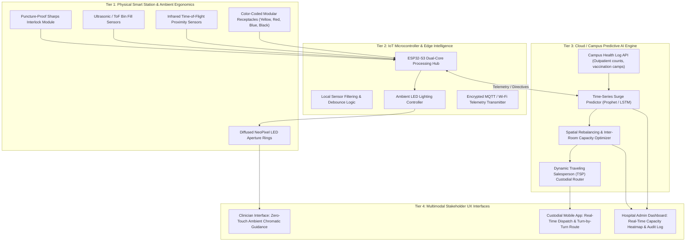

# Proposed Design Evolution: AI-Powered Adaptive Medical Waste System (AI-AMWS)

**Project Group:** Group M  
**Concept Classification:** Intelligent Socio-Technical Artifact & Healthcare UX System  

---

## 1. System Overview & Philosophical Shift

Current biomedical waste bins are **passive, static receptacles** that place 100% of the cognitive and physical burden on busy healthcare workers and custodial personnel. When clinical pressure surges, this passive model breaks down, resulting in mis-segregation, toxic environmental contamination, and needle-stick injuries.

The **AI-Powered Adaptive Medical Waste System (AI-AMWS)** transforms waste management from a passive, rigid infrastructure into an **intelligent, context-aware socio-technical system**. It integrates physical ambient ergonomics, IoT fill and proximity sensing, and predictive cloud/edge AI analytics.

---

## 2. End-to-End System Architecture

---

## 3. Four Core Architectural Innovations

### Innovation 1: AI Peak Day & Volume Prediction (Facility Level)
* **Problem Solved:** Waste generation in a campus clinic is highly non-linear. Regular weekdays generate 15–20 kg of waste, but vaccination drives, sports events, or seasonal viral spikes generate 80+ kg, overwhelming static bins.
* **Algorithmic Engine:** A lightweight time-series model (e.g., Prophet or LSTM) running on the campus server, fed by historical OPD footfall data, academic calendar events (convocation, exam stress periods), and regional epidemiologic alerts.
* **Predictive Horizon:** Generates 24 to 48-hour forward forecasts.
* **UX Impact:** Delivers actionable proactive alerts to the facility administrator at 07:00 AM:
  > *"Notice: High flu vaccine turnout predicted today. Yellow bio-hazard waste projected to surge by 320%. Recommend deploying 2 supplemental Yellow modular bins to Triage Station prior to 09:00 AM."*

### Innovation 2: Dynamic Bin Sizing & Room Allocation Analytics (Room Level)
* **Problem Solved:** In static setups, the Minor OT's Red bin routinely overflows during surgical suturing while the adjacent OPD consultation room's Red bin sits 90% empty.
* **Mechanism:** Ultrasonic/ToF fill sensors track real-time fill velocity ($\frac{\Delta \text{Volume}}{\Delta t}$).
* **Spatial Load Rebalancing:** The analytics engine evaluates cross-room utilization and alerts custodial staff to reallocate modular bin capacities or perform targeted mid-shift bag swaps, balancing loads across the building.

### Innovation 3: Interactive Point-of-Disposal Visual Guidance (Bin Level)
* **Problem Solved:** Medical staff experiencing cognitive tunnel vision under clinical emergency frequently commit action slips (e.g., throwing contaminated gloves into the nearest open bin regardless of color).
* **Interaction Sequence:**
  1. **Ambient State:** Low-luminance breathing glow indicating bin online status and capacity ($<50\%$ green, $50\text{--}80\%$ amber, $>80\%$ pulsing red).
  2. **Proximity Trigger ($<60\text{ cm}$):** As the clinician approaches with waste, narrow-beam IR proximity sensors detect the approaching hand and dynamically illuminate the aperture rim with high-contrast, official CPCB category color (Yellow, Red, Blue, Black).
  3. **Visual Confirmation:** Upon disposal, a gentle green luminous pulse provides unambiguous feedback that the interaction succeeded.
* **Cognitive Benefit:** Eliminates reliance on reading small printed labels, reducing decision latency from 3.5 seconds to under 0.4 seconds.

### Innovation 4: Smart Maintenance Routing & Custodial Mobile App (Workflow Level)
* **Problem Solved:** Housekeeping workers currently walk rigid, clock-based routes, arriving at full bins too late and servicing empty bins unnecessarily.
* **Routing Algorithm:** A dynamic route optimizer that schedules cleaning runs based on two hard constraints:
  1. *Capacity Trigger:* Fill level reaches $75\%$.
  2. *Regulatory Holding Limit:* Indian BMW Rules mandate bio-medical waste cannot be stored beyond 48 hours; system enforces strict 12-hour room-level clearance for anatomical and infectious waste.
* **Custodial UX:** A high-contrast mobile app displays a simplified floor plan with turn-by-turn room clearance checklists prioritized by urgency.

